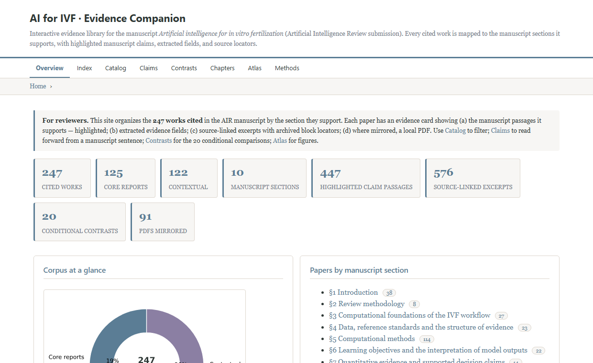
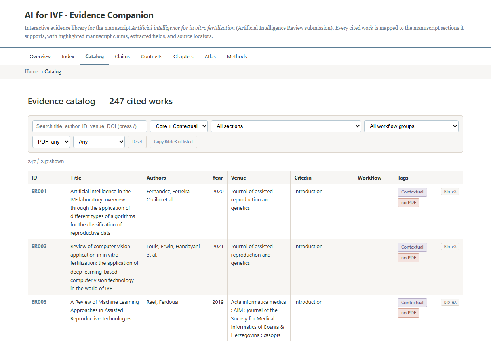

# AI for IVF — Evidence Companion

[](https://yukun-wen.github.io/AIR-evidence-companion/)
[](https://yukun-wen.github.io/AIR-evidence-companion/catalog.html)
[](https://yukun-wen.github.io/AIR-evidence-companion/sections.html)
[](https://yukun-wen.github.io/AIR-evidence-companion/contrasts.html)
[](https://yukun-wen.github.io/AIR-evidence-companion/atlas.html)
[](NOTICE.md)

**Companion site → https://yukun-wen.github.io/AIR-evidence-companion/**

---

## Abstract

This repository accompanies the manuscript *Artificial intelligence for in vitro
fertilization* (submitted to *Artificial Intelligence Review*). It is an
interactive, openly accessible evidence library in which each of the **247 cited
works** is mapped to the manuscript section it supports, annotated with the
verbatim claim passages it substantiates, enriched with machine-extracted
evidence fields, and—where redistribution is permitted—mirrored as a PDF whose
supporting passages are highlighted in situ. The resource is designed to make
the evidentiary basis of the review inspectable at the level of individual
sentences, and to serve as a reproducible record of the citation network.

*Keywords — in vitro fertilization · artificial intelligence · evidence
synthesis · citation mapping · reproducible review*

[Overview](#overview) · [Contents](#2-contents) · [Reading conventions](#3-reading-conventions) · [Reproducibility](#4-reproducibility) · [Data](#5-data-availability--licensing) · [Citation](#6-citation)

---

## Overview

Narrative reviews routinely cite hundreds of primary studies, yet the reader
typically sees only the aggregated claim. This companion inverts that
arrangement: **every citation is anchored** to the manuscript sentence that
invokes it, to the evidence fields extracted from the source, and to a
sha256-pinned locator in the archived full text. Each claim can therefore be
traced back to its source rather than taken on trust.

| | |
|---|---|
| **Corpus** | [247 cited works](https://yukun-wen.github.io/AIR-evidence-companion/catalog.html) · [125 core reports](https://yukun-wen.github.io/AIR-evidence-companion/catalog.html) · [122 contextual](https://yukun-wen.github.io/AIR-evidence-companion/catalog.html) |
| **Structure** | [8 manuscript sections](https://yukun-wen.github.io/AIR-evidence-companion/sections.html) · [9 workflow groups](https://yukun-wen.github.io/AIR-evidence-companion/az.html) |
| **Analysis** | [20 conditional contrasts](https://yukun-wen.github.io/AIR-evidence-companion/contrasts.html) · [12 charts](https://yukun-wen.github.io/AIR-evidence-companion/atlas.html) |
| **Full text** | [91 mirrored PDFs](https://yukun-wen.github.io/AIR-evidence-companion/atlas.html) · 58 with in-situ highlight marks |
| **Format** | Static site — no build step; works offline from `index.html` |

<p align="center"><em>Landing view — corpus statistics, section links, key figures.</em></p>
<p align="center"><a href="https://yukun-wen.github.io/AIR-evidence-companion"></a></p>

<p align="center"><em>Catalog — sortable, searchable record of all cited works.</em></p>
<p align="center"><a href="https://yukun-wen.github.io/AIR-evidence-companion/catalog.html"></a></p>

## 1. Design

The library is organized around four linked views of the same corpus:

- **Forward —** `claims.html` reads *from* a manuscript sentence *to* the works
  it cites; each passage is shown verbatim in context.
- **Backward —** each paper's `card.html` shows the claim(s) it supports, its
  extracted fields, and its locators, so a work can be evaluated in place.
- **Cross-cut —** `catalog.html` exposes the whole record as a sortable,
  searchable table with BibTeX export of any filtered subset.
- **Synthetic —** `atlas.html` and `contrasts.html` aggregate the corpus into
  charts and the 20 conditional within-report comparisons.

## 2. Contents

| Resource | Contents |
|---|---|
| [`index.html`](https://yukun-wen.github.io/AIR-evidence-companion) | Corpus statistics, section links, key figures |
| [`catalog.html`](https://yukun-wen.github.io/AIR-evidence-companion/catalog.html) | Sortable / searchable table; `/` focuses search; bulk BibTeX export |
| [`claims.html`](https://yukun-wen.github.io/AIR-evidence-companion/claims.html) | Claim passages → supporting citations |
| [`contrasts.html`](https://yukun-wen.github.io/AIR-evidence-companion/contrasts.html) | 20 conditional within-report comparisons (C01–C20) |
| [`sections.html`](https://yukun-wen.github.io/AIR-evidence-companion/sections.html) | Chapter-level index of cited works |
| [`atlas.html`](https://yukun-wen.github.io/AIR-evidence-companion/atlas.html) | Charts, manuscript figures, interactive section × workflow explorer |
| [`methods.html`](https://yukun-wen.github.io/AIR-evidence-companion/methods.html) | Construction pipeline, record schema, verification status |
| [`az.html`](https://yukun-wen.github.io/AIR-evidence-companion/az.html) | Indices by section, workflow group, author initial, year |
| `papers/<section>/<ID>/` | Evidence card, rendered page, mirrored + highlighted PDF |

## 3. Reading conventions

| Cue | Interpretation |
|---|---|
| Yellow `<mark>` | Verbatim manuscript passage citing the work — the claim it supports |
| Orange `mark.field` | Machine-extracted evidence field (task, inputs, method, split, validation) |
| `<ID>-Bxxxx` | Block locator into the archived source text, sha256-pinned |
| *Highlighted-PDF* button | Mirrored PDF with supporting sentences marked in situ |
| *human verification pending* | Machine-derived; confirm against the original before reliance |

<details>
<summary><b>Corpus composition</b> — counts by role, workflow and section (expand)</summary>

| Dimension | Count |
|---|---|
| Cited works | 247 |
| Core empirical reports | 125 |
| Contextual sources | 122 |
| Mirrored PDFs | 91 |
| PDFs with highlight marks | 58 |
| Conditional contrasts | 20 |
| Manuscript sections | 8 |
| Machine-readable records | `data/papers.json` |

</details>

## 4. Reproducibility

The site is fully static and regenerates deterministically:

```bash
# Python ≥3.10 · matplotlib · PyMuPDF
python _build/build_site.py      # pages, cards, charts, link QA
python _build/highlight_pdfs.py  # PDF highlight annotation
```

Each run ends with a dead-link QA pass (`_build/build_report.json`);
acquisition and highlight logs are kept under `_build/` for audit.

## 5. Data availability & licensing

Full texts are mirrored only where a local copy already existed or an
open-access version was retrievable via OpenAlex, Unpaywall, or Europe PMC;
paywalled works are represented solely by their DOI — no licensed content is
redistributed. See `NOTICE.md` and `_build/pdf_acquisition_log.json`.

## 6. Citation

If you use this companion, please cite the manuscript it accompanies. A BibTeX
entry for every cited work can be copied from its card, or a filtered set can
be exported in bulk from `catalog.html`.

---

*Compiled by automated extraction and cross-referencing for reviewer inspection.
Pipeline documented at [`methods.html`](https://yukun-wen.github.io/AIR-evidence-companion/methods.html).*
